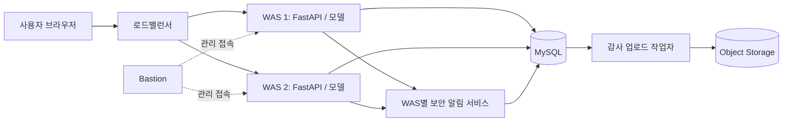

# 실시간 이상 금융 거래 탐지 및 차단 시스템

모의 이체를 입력하면 머신러닝 모델이 정상·이상 거래를 판정하고, 차단 결과와 감사 기록을 확인하는 FDS(Fraud Detection System) 미니 프로젝트입니다.

**FastAPI · scikit-learn Random Forest · MySQL · KakaoCloud Object Storage**

> 이 프로젝트는 교육용 모의 시스템입니다. 실제 계좌 조회, 출금, 입금 및 결제망 차단은 수행하지 않습니다.

## 주요 기능

- **모의 이체**: 직접 입력하거나 정상·거래 이상·시간/거리 이상 사례 버튼으로 테스트합니다.
- **이상 거래 판정**: 두 모델의 점수와 기준값을 비교해 승인 또는 차단하고, 결과 화면에 차단 원인을 표시합니다.
- **보안 알림**: 차단 이벤트를 별도 보안 서비스가 조회하고 웹 화면에 알림을 표시합니다.
- **거래 내역과 통계**: 거래 ID와 차단 원인을 확인하고 최근 7일의 승인·차단 건수를 조회합니다.
- **감사 기록**: 거래와 감사 이벤트를 DB에 함께 저장하고, 별도 작업자가 오브젝트 스토리지에 전달합니다.

## 시스템 구성



카카오클라우드 WAS 두 대에서 앱과 보안 서비스, 감사 작업자를 실행합니다. WAS는 MySQL을 공유하고, 감사 작업자가 S3 호환 오브젝트 스토리지에 이벤트를 업로드합니다. 보안 서비스는 **WAS의 별도 프로세스**이며 독립된 보안 서버는 아닙니다. Bastion은 서버 관리 접속에 사용합니다.

실제 네트워크의 전체 서브넷 및 보안 그룹 규칙은 이 그림에 표현하지 않았습니다.

## 판정 방식

이체 요청에는 두 개의 Random Forest 모델을 사용합니다. **어느 하나라도 해당 모델의 기준값 이상이면 차단**하고, 둘 다 기준값 미만이면 승인합니다.

| 모델 | 학습 데이터 | 사용 입력 | 기준값 |
| --- | --- | --- | ---: |
| 거래 패턴 | [PaySim 공개 합성 모바일 거래 데이터](https://www.kaggle.com/datasets/ntnu-testimon/paysim1) | 금액, 거래 전 잔액, 거래 유형 | 약 0.5656 |
| 시간·거리 | 직접 생성한 가상 데이터 | 거래 시간, 직전 거래와의 거리 | 약 0.58 |

웹에서 거래 유형은 `TRANSFER`로 고정합니다. 거리는 사용자가 직접 입력하며, 실제 위치나 거래 이력에서 계산하지 않습니다. 받는 은행·계좌·이름은 화면 확인용으로, 모델 입력과 서버 기록에 사용하지 않습니다. 모델 점수는 실제 사기 발생 확률을 보정한 값이 아닙니다.

### 모델별 평가

| 별도 테스트 지표 | 거래 패턴 모델 | 시간·거리 모델 |
| --- | ---: | ---: |
| 테스트 건수 | 103,573 | 2,000 |
| 정상 중 정상 판정 | 101,833 / 101,973 | 1,739 / 1,945 |
| 사기 중 탐지 | 1,458 / 1,600 | 15 / 55 |
| 사기 재현율 | 91.1% | 27.3% |
| 사기 정밀도 | 91.2% | 6.8% |

거래 모델은 시간순 분할, 시간·거리 모델은 계층화 무작위 분할로 평가했습니다. 서로 다른 합성 데이터의 결과이며 **두 모델을 결합한 전체 정책의 성능은 검증하지 않았습니다.** 특히 시간·거리 모델의 낮은 탐지 성능을 개선해야 합니다.

자세한 입력과 기준은 [판정 기준](docs/detection-criteria.md), 시연값과 평가 설명은 [시연 시나리오](docs/demo-scenarios.md)를 참고하세요.

## 로컬 실행

### 준비

- Python 3.12 권장, `venv` 및 `pip`
- 저장소에 포함된 `models/fds_model.pkl`, `models/paysim_model.pkl`, `models/context_model.pkl`

```bash
git clone https://github.com/fds-kakaocloud-team/fds-demo-public.git
cd fds-demo-public
python3 -m venv .venv
source .venv/bin/activate
pip install -r requirements.txt
```

Windows에서는 `source .venv/bin/activate` 대신 `.venv\Scripts\activate`를 사용하세요. `joblib`/pickle 모델 파일은 신뢰할 수 있는 출처에서만 로드하세요.

### 앱과 알림 서비스 실행

터미널 두 개에서 각각 실행합니다. 기본 저장소는 같은 프로젝트의 SQLite 파일 `data/fds.sqlite3`입니다.

```bash
# 터미널 1: FDS 앱
uvicorn app.main:app --host 127.0.0.1 --port 8000
```

```bash
# 터미널 2: 보안 알림 서비스
source .venv/bin/activate
uvicorn app.security:app --host 127.0.0.1 --port 5001
```

- 웹: [http://127.0.0.1:8000/](http://127.0.0.1:8000/)
- API 문서: [http://127.0.0.1:8000/docs](http://127.0.0.1:8000/docs)
- 헬스체크: `GET /health`

### 빠른 시연

1. **계좌 이체**에서 `정상 사례`를 누르고 **다음 → 이체하기**를 눌러 승인 결과를 확인합니다.
2. `거래 이상 사례` 또는 `시간·거리 이상 사례`로 차단 결과와 모델별 기준을 확인합니다.
3. **보안 알림**과 **거래 내역**에서 금액·차단 원인·거래 ID를 비교합니다.
4. **거래 통계**에서 최근 7일의 승인·차단 건수를 확인합니다.

사례 버튼은 입력값만 채웁니다. 거래는 이체하기를 눌렀을 때 저장됩니다. 통계에는 테스트 거래가 포함되며 모델 정확도를 의미하지 않습니다. 모델을 재학습하면 시연 결과가 달라질 수 있습니다.

### 테스트

```bash
pip install -r requirements-dev.txt
python -m unittest discover -s tests -v
```

별도의 공개 신용카드 실험 모델과 사례 데이터가 없으면 관련 테스트는 건너뜁니다. 이 모델은 모의 이체에 사용되는 PaySim 모델과 별개입니다.

## API와 저장 흐름

| 경로 | 설명 |
| --- | --- |
| `POST /transactions` | 모의 거래 판정 및 거래·감사 이벤트 저장 |
| `GET /transactions` | 최근 거래 내역 조회 |
| `GET /security/alerts` | 보안 서비스의 차단 알림 조회 |
| `GET /statistics` | 한국 시간 기준 최근 7일 집계 |
| `GET /audit-events` | 최근 감사 이벤트 조회 |
| `GET /health` | 필수 모델 및 저장소 상태 확인 |

MySQL 환경에서는 `fds_transactions`와 `fds_audit_outbox`에 거래와 이벤트를 같은 트랜잭션으로 저장합니다. 감사 작업자가 outbox를 읽어 JSON을 업로드하며 실패 시 재시도합니다. 스토리지 업로드는 거래 요청과 비동기로 처리됩니다.

웹은 보안 서비스를 2초 간격으로 조회합니다. 알림은 브라우저가 열려 있을 때 화면에 표시되며 문자·이메일 등 외부 채널은 없습니다.

## 배포와 설정

`deploy/schema.sql`에 MySQL 테이블 정의, `deploy/fds.env.example`에 환경변수 예시, `deploy/`에 systemd 서비스와 업데이트 스크립트가 있습니다. `FDS_STORAGE=mysql` 설정 시 MySQL 백엔드를 사용합니다. 감사 작업자는 DB와 S3 호환 스토리지 설정이 필요합니다.

서버별 배포는 로드밸런서 상태와 중단 여부를 확인하고 진행하세요. `deploy/update.sh`는 서비스가 중지된 상태를 전제로 합니다. GitHub에 push해도 서버에 자동 배포되지는 않습니다. 비밀번호와 인증 파일은 서버에 별도로 두고 Git에 저장하지 않습니다.

## 프로젝트 구조

```text
app/                  API, 저장소, 보안 알림, 감사 작업자
app/static/           모의 이체 웹 화면
models/               추론 모델과 평가 결과
scripts/              데이터 생성, 모델 학습 및 평가
deploy/              SQL, 환경변수 예시, systemd 설정
docs/                판정 기준과 시연 시나리오
tests/               API·저장·시연 흐름 테스트
```

## 범위와 한계

- 실제 금융 거래를 처리하지 않으며 사용자 인증도 구현하지 않았습니다. 접근 범위를 제한해 시연하세요.
- 시간·거리 모델은 직접 만든 라벨을 학습했고 성능이 낮습니다. 전체 정책은 공동 정답 데이터로 평가해야 합니다.
- 보안 알림은 화면 조회 방식이며, 외부 메시지 발송이나 별도의 보안 서버는 없습니다.
- 운영 환경 적용에는 접근 제어, DB TLS, 감사 로그 보존·변조 방지, 장애 대응 등 추가 설계가 필요합니다.

## 데이터 출처

거래 모델은 Edgar Alonso Lopez-Rojas 등이 만든 [PaySim 공개 합성 데이터](https://www.kaggle.com/datasets/ntnu-testimon/paysim1)를 사용했습니다. 원본 데이터는 저장소에 포함하지 않으며 데이터 사용 조건은 원본 페이지를 확인하세요. 시간·거리 모델은 자체 생성한 가상 데이터를 사용합니다.
